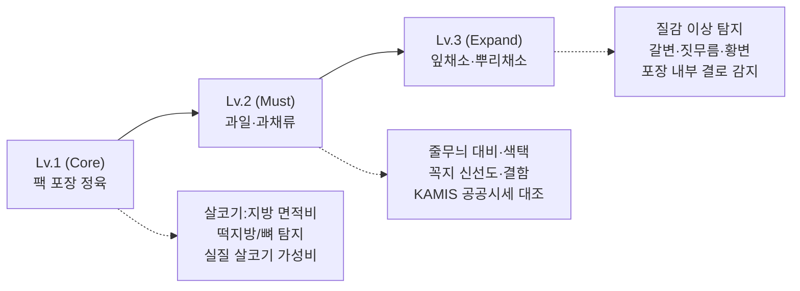
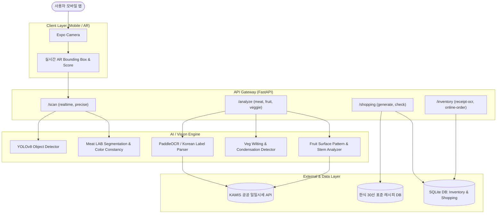

# 🛒 FreshScanner (프레시스캐너)

> **오프라인 현장형 AI 장보기 의사결정 서비스**  
> 온라인 최저가 비교나 단순 냉장고 관리가 아닌, **오프라인 마트·시장 매대 앞에서 소비자가 직접 고르는 실물 신선식품(정육·과일·채소)의 외관 품질과 실질 가성비를 실시간 AR 및 딥러닝 비전으로 분석해 최고의 상품을 골라주는 현장형 AI 스캐너**

[](https://www.python.org/)
[](https://fastapi.tiangolo.com/)
[](https://www.apache.org/licenses/LICENSE-2.0)
[](#)
[](#)

---

## 1. 해결하고자 하는 문제 (Pain Points)

1. **오프라인 신선식품 선택의 불확실성**
   - **정육:** 팩 포장된 고기의 비계 비율이나 떡지방, 오돌뼈 위치 등을 눈대중으로만 봐서는 실제 가성비를 계산하기 어렵고 매대 조명 때문에 육색 판단이 흐려짐.
   - **과일·채소:** 산처럼 쌓여 있는 과일 매대에서 어떤 것이 당도가 높고 신선한지 외관 기준(색택, 꼭지, 줄무늬 등)을 알기 어려우며, 오늘 매장 가격이 시세 대비 합리적인지 현장에서 즉시 파악하기 힘들어 충동구매 실패 확률이 높음.
2. **기존 장보기·레시피 앱의 한계**
   - 기존 서비스는 '집에서 요리할 때'나 '온라인 규격 상품 최저가 비교'에만 초점이 맞춰져 있음.
   - 정작 소비자가 가장 큰 어려움을 겪는 **"오프라인 매대 눈앞에 놓인 비규격 상품 A와 B 중 무엇을 집어야 하는가?"**에 대한 해답을 주지 못함.

---

## 2. 핵심 타겟 품목 및 3단계 확장 전략



### 🥩 Lv.1 (Core) · 팩 포장 정육
- **타겟:** 삼겹살, 목살, 한우 등
- **AI 비전 핵심 분석 지표:**
  - **살코기 : 지방 면적 비율(%)** LAB 색공간 정밀 분할
  - **떡지방(뭉친 비계) 및 뼈(오돌뼈·갈비뼈)** 크기 및 위치 감지
  - 매대 조명 보정(Gray-World) 후 **실제 육색(선홍빛 vs 갈변)** 및 핏물 감지
- **가격·가성비 결합:** 팩 라벨 OCR(100g당 단가) × 순수 살코기 비율 = **'실질 살코기 가성비' 산출**

### 🍎 Lv.2 (Must) · 과일·과채류
- **타겟:** 수박, 사과, 한라봉, 포도, 샤인머스캣, 딸기 등
- **AI 비전 핵심 분석 지표:**
  - **표면 패턴 및 색택:** 수박 줄무늬 선명도, 샤인머스캣 황금빛 분포 등
  - **꼭지·줄기 신선도:** 마름·시듦 정도 및 녹색도 분석
  - **표면 결점:** 멍, 상처 흔적 패치 이상 탐지
- **가격·가성비 결합:** 매대 가격표(POP) OCR × **KAMIS(농수산식품유통공사) 일일 시세 API** = **'오늘 시세 대비 저렴한 정도' 브리핑**

### 🥬 Lv.3 (Expand) · 나물·잎채소·뿌리채소
- **타겟:** 상추, 시금치, 봄나물, 대파 등
- **AI 비전 핵심 분석 지표:**
  - 잎 끝 짓무름·갈변 비율 (%) 및 에지 무름(Wilting) 감지
  - 엽록소 소실 황백화(Yellowing) 비율 감지
  - 포장 내부 물방울(결로) 맺힘 탐지

---

## 3. 핵심 기능 상세

### ① 2단계 듀얼 비전 (Dual-Vision) 스캔 UX
1. **1단계 : 실시간 AR 스캐너 (탐색 및 후보 압축)**
   - 매대를 카메라로 훑으면 다중 객체 탐지(YOLO)를 통해 각 상품 위에 실시간 기본 점수 오버레이.
   - *"📸 최종 후보를 사진으로 촬영하면 미세 품질 및 정밀 분석 정확도가 올라갑니다"* 안내.
2. **2단계 : 고화질 정밀 분석 (최종 의사결정)**
   - 셔터를 누르면 고해상도 이미지를 기반으로 픽셀 세그멘테이션 및 라벨 OCR을 정밀 수행하여 최종 1위 상품 추천 리포트 제공.

### ② 설명 가능한 AI (XAI) 3단 리포트 구조
- **AI 종합 점수:** (예: 91점, 주변 매대 중 실질 가성비 1위)
- **판단 근거 (Why):**
  - `[황금 비율]` 살코기 73% : 지방 27%로 구이용 최적 비율
  - `[결함 없음]` 우측 하단 오돌뼈 외 뭉친 떡지방 없음 (컬러 마스킹 제공)
  - `[실질 가성비]` 순수 살코기 기준 가성비 단가 브리핑
- **사용자 최종 체크 (Human Check):**
  - *"팩 아래쪽에 겹쳐서 보이지 않는 아랫줄 고기에 과도한 비계가 숨어있지 않은지 옆면을 살짝 기울여 확인해 보세요."*

### ③ 무입력(Zero-Effort) 재고 동기화 & 장보기 준비
- **영수증 OCR + 정규화:** 종이 영수증 촬영 시 표준 식재료 DB로 자동 등록.
- **온라인 주문 복붙:** 쿠팡·마켓컬리 주문내역 스크린샷 텍스트 복붙 시 재고 자동 추가.
- **초간단 타겟 세팅:** 먹을 메뉴(예: `된장찌개`, `제육볶음`) 선택 시 냉장고 보유 재료 자동 차감 후 현장 체크리스트 생성.

---

## 4. 시스템 아키텍처



---

## 5. 프로젝트 디렉터리 구조

```text
fresh-scanner/
├── backend/
│   └── app/
│       ├── api/
│       │   ├── analyze.py         # 카테고리별(육류/과일/채소) 정밀 분석 API
│       │   ├── inventory.py       # 냉장고 재고, 영수증 OCR, 주문 파싱 API
│       │   ├── scan.py            # 1단계 AR 실시간 및 2단계 정밀 스캔 API
│       │   └── shopping_list.py   # 장보기 목록 자동 생성 및 체크 API
│       ├── db/
│       │   ├── database.py        # SQLAlchemy 비동기 DB 설정
│       │   └── models.py          # InventoryItem, ShoppingListItem ORM
│       ├── models/
│       │   ├── detector.py        # YOLOv8 경량 객체 탐지 래퍼
│       │   ├── fruit_analyzer.py  # 과일 표면 줄무늬·꼭지·결함 분석기
│       │   ├── meat_segmentor.py  # 정육 살코기/지방/뼈 픽셀 분할기
│       │   └── vegetable_analyzer.py # 채소 갈변/황변/결로 탐지기
│       ├── services/
│       │   ├── detection.py       # 실시간 AR 감지 서비스
│       │   ├── fruit_analyzer.py  # 과일 분석 비즈니스 서비스
│       │   ├── inventory.py       # 냉장고 재고 CRUD 서비스
│       │   ├── kamis_api.py       # KAMIS 공공 도·소매 시세 API 연동
│       │   ├── llm.py             # 영수증/온라인 주문 텍스트 정규화 파서
│       │   ├── meat_analyzer.py   # 육류 정밀 분석 서비스
│       │   ├── ocr_service.py     # 한국어 라벨/가격표/영수증 OCR 파서
│       │   ├── price_analyzer.py  # 실질 살코기 가성비 산출 엔진
│       │   ├── quality.py         # 2단계 정밀 분석 오케스트레이터
│       │   ├── recipe_db.py       # 한식 30선 소요 식재료 레시피 DB
│       │   ├── shopping.py        # 쇼핑 목록 자동 차감 생성기
│       │   ├── vegetable_analyzer.py # 채소 분석 서비스
│       │   └── xai_reporter.py    # 3단 XAI 리포트 포매터
│       ├── config.py              # Pydantic 설정 관리
│       ├── main.py                # FastAPI 엔트리포인트 및 라우터 등록
│       └── schemas.py             # Pydantic 데이터 모델 (DTO)
├── data/
│   └── sample_images/             # 테스트용 샘플 이미지
├── ml/
│   ├── configs/                   # 모델 학습 설정 (YOLO seg, ResNet)
│   ├── export/                    # 온디바이스 배포용 ONNX 변환 스크립트
│   └── training/                  # 정육 분할 및 과일 등급 학습 파이프라인
├── mobile/                        # React Native / Expo 모바일 앱 스텁
│   ├── package.json
│   └── src/App.tsx                # AR 카메라 뷰 및 2단계 리포트 UI
├── scripts/
│   ├── setup.sh                   # 환경 셋업 쉘 스크립트
│   └── test_api.py                # 전체 API 통합 검증 스크립트
├── .env.example
├── .gitignore
├── Dockerfile
├── docker-compose.yml
├── requirements.txt
└── README.md
```

---

## 6. 설치 및 실행 가이드

### 1) 환경 설정 및 의존성 설치
```bash
# 가상환경 생성 및 활성화
python -m venv venv
# Windows:
.\venv\Scripts\activate
# Linux/macOS:
source venv/bin/activate

# 의존성 설치
pip install -r requirements.txt
```

### 2) 환경 변수 설정
```bash
cp .env.example .env
# .env 파일에서 KAMIS_API_KEY 및 OPENAI_API_KEY(선택사항) 설정
```

### 3) FastAPI 백엔드 서버 실행
```bash
uvicorn backend.app.main:app --reload --host 0.0.0.0 --port 8000
```
- API Swagger 문서: `http://localhost:8000/docs`
- 헬스체크: `http://localhost:8000/health`

### 4) Docker로 실행
```bash
docker-compose up --build
```

---

## 7. 주요 API 명세

| 엔드포인트 | 메서드 | 설명 |
|---|---|---|
| `/scan/realtime` | POST | 1단계 AR 실시간 탐지 (바운딩박스, 클래스, 간이 품질 점수) |
| `/scan/precise` | POST | 2단계 고화질 정밀 분석 (XAI 3단 리포트, 세그멘테이션 마스크) |
| `/analyze/meat` | POST | 정육 살코기:지방 비율, 떡지방, 육색, 라벨 단가 분석 |
| `/analyze/fruit` | POST | 과일 표면 패턴, 꼭지 신선도, 결함, KAMIS 시세 비교 |
| `/analyze/vegetable` | POST | 채소 잎 끝 갈변, 황변, 포장 내부 결로 탐지 |
| `/inventory/` | GET | 냉장고 등록 식재료 목록 조회 |
| `/inventory/receipt-ocr` | POST | 마트 종이 영수증 사진 업로드 → 재고 자동 등록 |
| `/inventory/online-order`| POST | 쿠팡·마켓컬리 주문내역 텍스트 복붙 → 재고 자동 등록 |
| `/shopping/generate` | POST | 메뉴 선택 → 한식 레시피 소요량 - 냉장고 재고 차감 목록 생성 |
| `/shopping/{id}/check` | PATCH | 장보기 체크리스트 체크/해제 토글 |

---

## 8. 라이선스

본 프로젝트는 [MIT License](LICENSE)에 따라 자유롭게 사용 및 수정할 수 있습니다.
